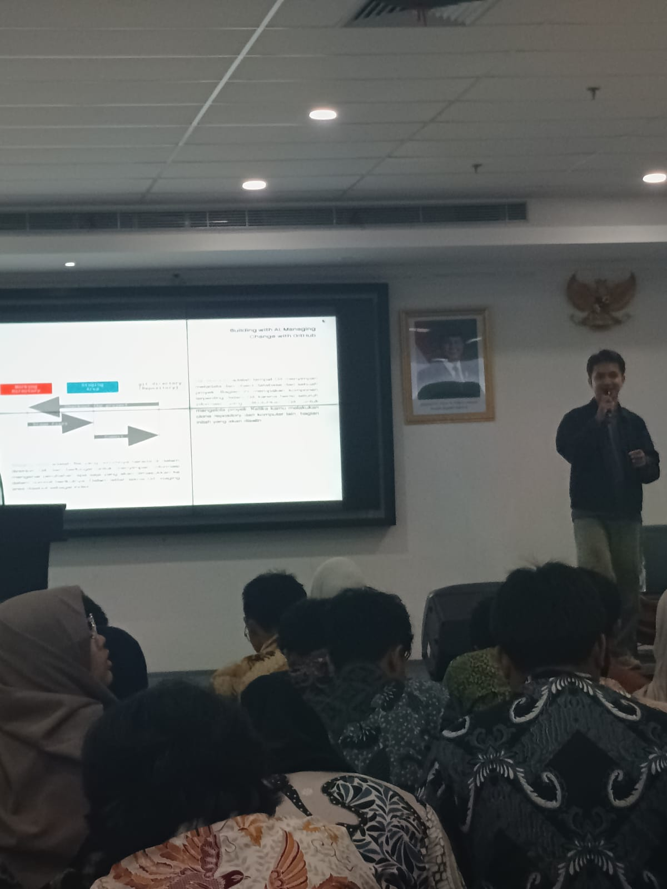

# Student Task Planner

## Informasi Peserta
* **Nama Lengkap:** Rama Alfajri

---

## Deskripsi Repository
Repository ini berisi kodingan aplikasi web **Student Task Planner** beserta dokumentasi lengkap hasil pembelajaran pada kegiatan workshop *Building with AI, Managing Change with GitHub*.

---

## Tujuan dan Kegunaan Repository
* **Pengelolaan Proyek:** Menyimpan dan mengelola versi kode program aplikasi pencatat tugas berbasis web secara terstruktur menggunakan Git dan GitHub.
* **Dokumentasi Pembelajaran:** Menjadi acuan dan portofolio pembelajaran mengenai integrasi penggunaan teknologi AI (*Prompt Engineering*) dan *Version Control System* (Git & GitHub).

---

## Dokumentasi Kegiatan Workshop

### 1. Rangkuman Materi Workshop
Selama kegiatan workshop, materi yang disampaikan terbagi menjadi 2 pilar utama:
* **Prompt Engineering untuk AI:**
  * Pembelajaran tentang cara menyusun instruksi (*prompt*) yang spesifik agar AI dapat menghasilkan output kodingan yang akurat dan relevan.
  * Penerapan struktur *prompt* ideal yang terdiri dari 4 elemen penting: **Role**, **Task**, **Context**, dan **Format**.
* **Manajemen Perubahan Kode (Git & GitHub):**
  * Pemahaman fungsi **Git** sebagai *Version Control System* (VCS) lokal untuk melacak setiap riwayat perubahan file proyek.
  * Pemahaman **GitHub** sebagai platform cloud berbasis web untuk menyimpan repository online dan berkolaborasi.
  * Penguasaan alur kerja Git dasar (*Git Workflow*): *Working Directory* - *Staging Area* (`git add`) - *Local Repository* (`git commit`) - *Remote Repository* (`git push`).

### 2. Poin-Poin Penting & Pengetahuan Baru
* **Context is Key:** Semakin detail konteks, batasan, serta aturan yang diberikan dalam sebuah *prompt* AI, semakin akurat kode program yang dihasilkan tanpa adanya *hallucination* atau pustaka yang tidak diperlukan.
* **Alur Perintah Git:** 
  * `git init`: Menginisialisasi folder proyek menjadi proyek berbasis Git.
  * `git add .`: Memindahkan seluruh perubahan file ke *Staging Area*.
  * `git commit -m "pesan"`: Menyimpan snapshot versi kode secara permanen di repository lokal.
  * `git push`: Mengunggah versi kode lokal ke cloud GitHub.
* **Integrasi VS Code & Terminal:** Penggunaan terminal internal VS Code memudahkan pengoperasian perintah CLI Git secara langsung saat pengodingan.

### 3. Pendapat Pribadi tentang Day 1 Proyek Workshop
Pengalaman mengikuti Day 1 Workshop ini sangat bermanfaat dan membuka wawasan baru. Kombinasi antara pengembangan web dibantu AI dan pengelolaan versi kode dengan Git membuat proses pembuatan proyek menjadi jauh lebih efisien. Saya menjadi lebih paham bagaimana alur kerja profesional dalam mengolaborasikan teknologi AI modern dengan standar industri seperti GitHub.

---

## Tampilan Proyek

